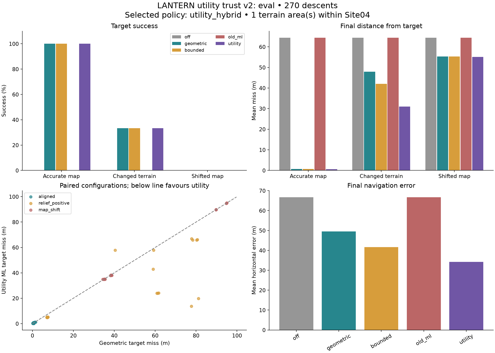

# Scan utility v2: completed results

**Follow-up:** the [Site01 transfer evaluation](SCAN_UTILITY_TRANSFER_RESULTS.md)
completed 810 descents with this frozen model. Mean miss improved modestly but
speed violations increased (39 to 47); successes stayed 54/162. The earlier
speed benefit reported below did not generalize to that batch.

22 October 2026. The updated model recovers the old ML veto's failure to accept
useful corrections. In a protected final test it **matched geometric matching's
target success rate, reduced mean miss, and reduced touchdown-speed violations**.
It did not solve shifted-map navigation or establish generalization across lunar
sites. Some landings still exceeded the horizontal-speed limit.

## Plain-language conclusion

The first model learned to refuse almost every correction. The replacement
learns how much of a proposed correction is useful, and limits large changes
near the surface. It now keeps the good corrections needed to reach the target.
With inaccurate terrain, it often reduces the damage from misleading corrections.

This is a measured improvement over the old ML policy on the same new cases.
Against the geometric baseline, the benefit is smaller target errors and fewer
excessive-speed contacts; the number of successful target landings is unchanged.

## Final test: 270 descents, 54 matched configurations

Each arm received the same 54 configurations in the reserved terrain area.
Success requires actual terrain contact, target miss <10 m, vertical impact
<2 m/s and horizontal impact <1 m/s. All 270 vehicles made contact, so contacts
alone would conceal the navigation failures.

| Policy | Target successes | Mean target miss | Speed-limit violations |
|---|---:|---:|---:|
| Matching OFF | 0/54 | 64.40 m | 0 |
| Geometric matching | 24/54 | 34.64 m | 12 |
| Classical bounded correction | 24/54 | 32.67 m | 12 |
| Previous ML veto | 0/54 | 64.40 m | 0 |
| **Updated utility ML** | **24/54** | **28.92 m** | **7** |

The utility policy reduced mean miss by 5.72 m (16.5%) relative to geometric
matching and by 3.75 m relative to the bounded rule. It improved target distance
in 41/54 paired configurations versus geometric matching, worsened 7 and tied 6.
These are descriptive differences within this area, not independent-site
confidence estimates. Zero speed violations for OFF/old ML accompanied zero
target successes: declining to navigate is not a solution.

| Map condition | Geometric success /18 | Utility success /18 | Geometric mean miss | Utility mean miss |
|---|---:|---:|---:|---:|
| Accurate map | 18/18 | 18/18 | 0.73 m | 0.59 m |
| Changed terrain | 6/18 | 6/18 | 47.90 m | 31.05 m |
| Shifted map | 0/18 | 0/18 | 55.29 m | 55.11 m |

All seven utility speed violations occurred in changed-terrain descents from
500 m. At 1500 m in changed terrain, utility had no speed violations versus
three for geometric matching, and mean miss was 11.37 m versus 25.29 m; both
had 6/9 target successes. Maximum final-test horizontal impact was 3.22 m/s for
utility versus 6.00 m/s geometric. The required limit remains 1 m/s, so the
utility policy is not ready for a safe-landing claim.

Six shifted-map configurations had no geometrically accepted scan: their
corrections reached the frozen matcher's conservative coarse-search boundary.
Other shifted-map configurations accepted shape matches but retained an absolute
coordinate bias. A global map translation cannot be uniquely diagnosed from
local shape alone. Independent registration information is still needed.

## What changed

**Broader development data:** collected 3,840 stationary poses /7,680 noisy scan
proposals across five older Site04 areas. Initial-error angles cover the circle;
magnitudes span near-zero through 140 m. True sensor positions vary within
180 m of each area's centre. Training includes raised/lowered terrain changes,
two map-shift directions and altitudes 300/600/1200/2000 m. Two scans per pose
provide short history without applying corrections during collection.

**A utility target:** instead of treating every correction leaving >10 m error
as bad, labels express the clipped least-squares fraction of the correction
that minimizes horizontal position error. A correction from 100 m error to
45 m can therefore receive credit. Truth generates labels and evaluation only.
The policy receives no truth pose or injected error during inference.

**Inputs that omit direction:** normalized fit RMS, heuristic confidence,
correction magnitude, measured altitude, proposal consistency after the last
applied correction, and a history-present flag. Signed correction components,
terrain IDs, map conditions, seeds and experiment arms are excluded. This avoids
direct memorization of the old finite set of injected error directions.

**Landing-based policy selection:** the model was fitted on original/area01/
area02. Area03/area04 supplied new validation scans and complete development
landings. Three fixed gain policies were compared with four controls in 672
development descents. The prewritten selection rule prioritized target success,
then fewer contact-speed violations, then lower mean miss. It selected
`utility_hybrid`: full gain for predictions >=0.75, otherwise predicted gain,
with correction magnitude limited to max(5 m,0.5*measured altitude).

Development utility/geometric success counts both equalled 32/96; speed
violations were 19 versus 32. The bounded rule had 30 violations and slightly
lower mean miss than utility, so development did not show uniform dominance.
The selected policy and model were frozen before final evaluation.

## Training and verification

The model is a 32-tree random-forest regressor, depth <=8, with 5,874 nodes and
a 230,940-byte portable JSON. Fitting used 4,172 geometrically accepted proposals
from the three training areas, weighting areas and cases equally. Validation
used 2,732 accepted proposals from the other two areas. Seed 11 was predetermined;
seeds 22/33 were sensitivity checks, not seed selection. There was no refit on
validation or final-test data.

Validation gain MAE was 0.213 versus 0.221 for always taking the full correction:
only a modest offline improvement. The closed-loop comparison was therefore
necessary. Gain predictions are not calibrated correctness probabilities.

Python and C# predictions matched on all 7,680 input fixtures, with maximum
difference 2.22e-16. Eight utility tests cover useful-but-inexact corrections,
harmful updates, partial optima, bounds, invalid inputs and double-precision
tree comparisons; the eight previous gate tests also pass. Unity checks include
direction invariance, bounds and geometric-rejection guards.

All collection/development/final records were checked: unique cases and scan
indices, independently recomputed labels and partial-correction geometry,
complete paired arms, identical initial observable inputs, policy routing,
contact/success criteria, trajectory/cloud files and frozen source/model/plan/
protocol hashes. The geometric core, estimator and guidance are unchanged.

The collection took 70.0 s, development descents 167.4 s and final descents
50.7 s of wall time. Smoke stages passed before full stages. Final combined
v1/v2 inference and gain evaluation took median 0.0211 ms, p95 0.0486 ms per
scan on this desktop, excluding scan generation/matching. These are not flight
computer or physical mission benchmarks.

## Limits and next step

Only one additional eligible nonoverlapping 2.4 km crop remained after excluding
the eight earlier crops. This was recorded before fitting, as allowed by the
protocol. Final evaluation therefore used one reserved Site04 area, rather than
three. The terrain area, error vectors, seeds, true start offset, bump shape,
map-shift direction and 1500 m altitude were excluded from model fitting and
policy selection, but they still share the same DEM and simulator.

The simulator uses synthetic sensors and idealized 3-DOF attitude response.
V2 has not increased the target-success count over geometric matching, and its
changed-terrain failures remain material. The next research check is a frozen
evaluation on independent terrain/data, alongside an independent map-registration
measurement and explicit correction/landing safeguards. Reuse these outcomes
for analysis, not as an untouched test after further tuning.

The original 102.5 km flight scene and older experiment outputs remain available.
This integration runs in the separate estimated-state Unity experiment.

## Significance and defensible contribution

This is substantial engineering and meaningful early applied research. The
testbed now measures how live terrain corrections affect estimated-state
guidance and actual contact outcomes, with simple baselines, a frozen final
evaluation and a preserved failed learned policy. The important finding is
that rejecting wrong proposals alone can worsen navigation; the replacement
policy shows a more useful error/speed tradeoff in the reserved-area test.

The measured contribution is a 16.5% mean-miss reduction and five fewer
contact-speed violations than geometric matching, with unchanged target
success (24/54). This is practical experimental progress, not a demonstrated
increase in landing success or established statistical significance. The
random forest and DEM-to-surface conversion do not by themselves establish
method novelty, and no literature-based novelty claim is made here.

Labels, data diversity, feature design and policy selection changed together.
Matched ablations are needed to isolate their contributions. The utility policy
was selected among three development variants; classical baselines need a
matched tuning budget in a stronger follow-up. Independent terrain evaluation,
map registration and explicit contact-speed safeguards remain priorities.
See the [updated project explanation and mentor summary](PROJECT_EXPLAINED_AND_REFOCUSED.md)
for the overall assessment and future goals.

## Evidence

- Frozen protocol: `SCAN_TRUST_PROTOCOL_V2.md`.
- Collection: `out/scan_utility/20261021_203240_collect/`.
- Model and sensitivity report: `out/scan_utility/model_v2/`.
- Development selection: `out/scan_utility/20261021_203615_dev/`.
- Final test: `out/scan_utility/20261021_204054_eval/`.
- Runtime: `LANTERN/Assets/Scripts/Experiments/ScanUtilityPolicy.cs`.
- Staged harness: `LANTERN/Assets/Editor/ScanUtilityRunner.cs`.
- Verification/summary: `tools/verify_scan_utility.py`, `tools/summarize_scan_utility.py`.

Raw records include partial gains and resulting errors. The raw `wrong` field
still describes a full proposed correction leaving >10 m error; `applied_bad`
describes the actual scaled update leaving >10 m error. Neither means that an
update increased error. Use `beneficial_applied`, error distances and complete
landing outcomes together when assessing utility.

