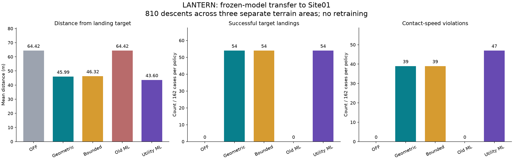

# Scan utility: frozen-model transfer to Site01

22 October 2026. **Completed: 810 descents across three separate terrain areas.**
No retraining or policy tuning. All 810 cases and 13,011 scan records passed
integrity checks. Unity Play mode is stopped.

## Main conclusion

The existing utility model retained a modest average-position benefit on Site01,
but **did not retain the earlier contact-speed benefit**. Compared with geometric
matching, mean target miss fell by 2.40 m (5.2%), target successes stayed at
54/162, and contact-speed violations increased from 39 to 47. The prewritten
transfer criterion therefore **failed**. This is a useful negative transfer
result, not evidence that the current model reliably improves landing safety.

The earlier Site04 result remains valid for that batch. It does not justify
assuming the same error/speed tradeoff on other terrain. Our next development
priority is understanding excessive sideways motion under map mismatch and
testing explicit contact-speed safeguards, with a new reserved evaluation.

## Final comparison

Each policy received the same 162 configurations: three areas, two altitudes,
three map conditions, three injected errors and three noise seeds. Success
requires actual terrain contact, target miss <10 m, vertical impact <2 m/s and
horizontal impact <1 m/s. All 810 vehicles contacted the ground.

| Policy | Successful target landings | Mean target miss | Speed-limit violations |
|---|---:|---:|---:|
| Matching OFF | 0/162 | 64.42 m | 0 |
| Geometric matching | 54/162 | 45.99 m | 39 |
| Classical bounded correction | 54/162 | 46.32 m | 39 |
| Previous learned veto | 0/162 | 64.42 m | 0 |
| Utility ML | 54/162 | 43.60 m | 47 |

Utility improved target distance in 105 paired configurations versus geometric,
worsened 39 and tied 18. Against bounded corrections it improved 103, worsened
41 and tied 18. These counts do not imply statistical independence across the
shared terrain. Zero speed violations in OFF/old ML accompanied zero successes.

## Where it works and fails

| Condition | Geometric success | Utility success | Geometric mean miss | Utility mean miss | Speed violations: geometric / utility |
|---|---:|---:|---:|---:|---:|
| Accurate map | 54/54 | 54/54 | 0.83 m | 0.63 m | 0 / 0 |
| Changed terrain | 0/54 | 0/54 | 82.16 m | 75.19 m | 39 / 47 |
| Shifted map | 0/54 | 0/54 | 54.99 m | 54.97 m | 0 / 0 |

All utility speed violations occurred under changed terrain. Both starting
altitudes contributed: 23/27 at 500 m and 24/27 at 1500 m. In that condition,
even utility's average miss exceeded matching OFF (64.45 m). Using a misleading
map can be worse than leaving the original estimate alone.

The effect varied by area:

| Area | Mean miss: geometric / utility | Speed violations: geometric / utility |
|---|---:|---:|
| Site01 transfer 01 | 61.55 / 59.59 m | 18 / 15 |
| Site01 transfer 02 | 41.11 / 32.73 m | 18 / 18 |
| Site01 transfer 03 | 35.32 / 38.47 m | 3 / 14 |

Area 03 explains the net speed regression: eleven additional violations there
outweighed three fewer in area 01. Utility's maximum horizontal impact was
6.21 m/s versus 8.24 m/s geometric; a lower maximum did not mean fewer violations
of the 1 m/s limit. All three areas retained 18/54 target successes per policy.
These observations locate the failure; they do not isolate its causal mechanism.

## What was controlled and verified

- The current Site04-trained random forest and selected hybrid policy were frozen.
  No model, feature, threshold, estimator, matcher or guidance changes.
- Source: NASA PGDA Site01 DEM. All three evaluation crops and the separate
  smoke crop lie outside the entire Site04 tile, verified in projected coordinates.
- Crop selection used slope and separation only. The 15-case smoke test used
  another crop and did not select a policy.
- Errors, seeds, altitudes, initial motion and map-perturbation families match
  the previous final matrix. Unity 6000.3.24f1 matches its archived environment.
- Verified model/source hashes, complete paired configurations, initial sensor
  inputs, gains, labels, contact criteria, trajectories and sparse clouds.
- Python inference matched recorded C# predictions on all new scan inputs.
  Independently checked archived ground/prior heights against the source raster,
  Unity triangle interpolation and the specified perturbations.

Full evaluation wall time was 298.0 seconds. Background execution was initially
disabled after Unity reopened; enabling it near case 150 removed scheduling
stalls. Physics retained its fixed 0.05 s step and seeded noise. Combined old/new
inference and gain evaluation had median 0.0145 ms and p95 0.0298 ms on this
desktop, excluding scan generation and matching.

The first smoke verification assumed bilinear Unity height sampling and failed.
A direct Unity probe confirmed triangle sampling; the verifier was corrected.
The raw data and simulation did not change. The repair record is retained.

## Research meaning and next work

This extends the evidence from one Site04 area to three nonoverlapping areas on
another lunar tile, and reveals a limitation that the earlier result concealed.
Site01 appeared in older, separate sensor studies; it was excluded from this
scan-utility model's fitting and policy selection, but is not globally unseen
project data. All crops still share a simulator and synthetic sensors.

We can defend the accurate-map navigation result and a modest pooled error
benefit from utility ML. We cannot claim a general contact-speed improvement.
Next, use these observed failures as development evidence, separate the effects
of learned gains and guidance with matched ablations, and evaluate a contact-speed
safeguard against equally tuned classical controls on a newly reserved test.
Independent registration remains necessary to address map-coordinate errors.

## Evidence

- [Frozen protocol](SCAN_UTILITY_TRANSFER_PROTOCOL.md)
- [Full report and per-area tables](../out/scan_utility_transfer/20261022_091502_eval/REPORT.md)
- [Verification record](../out/scan_utility_transfer/20261022_091502_eval/VERIFICATION.md)
- [Earlier Site04 results](SCAN_UTILITY_RESULTS.md)
- Final data: `out/scan_utility_transfer/20261022_091502_eval/`.
- Smoke data: `out/scan_utility_transfer/20261022_091135_eval_smoke/`.
- Reproduction: `tools/plan_scan_utility_transfer.py`,
  `tools/build_scan_utility_transfer.py`, `tools/summarize_scan_utility_transfer.py`.

