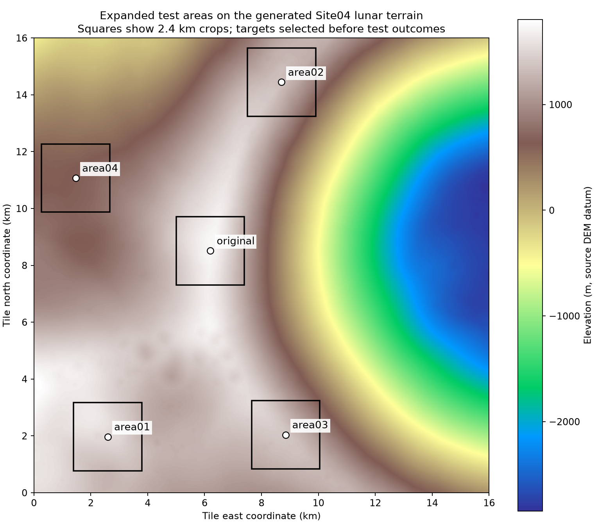
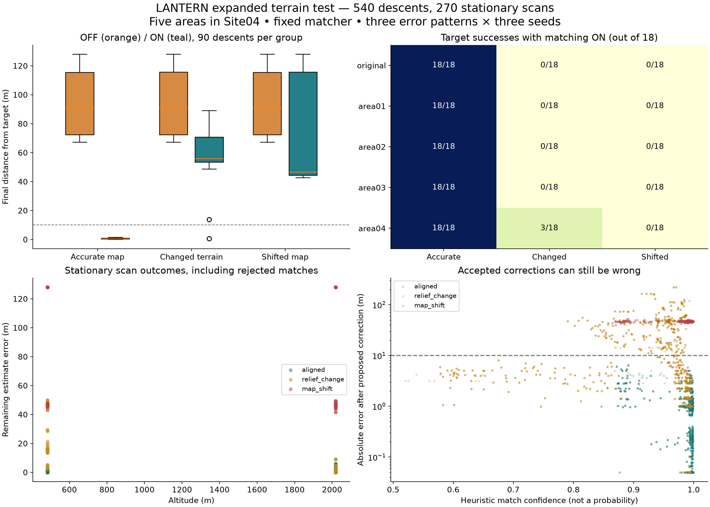

# Expanded lunar-terrain tests — 22 October 2026

Completed 270 stationary scans and 540 short descents (270 OFF/ON pairs) across
five widely separated patches of the generated Site04 surface. Starting
altitudes were 500 and 2000 m; initial horizontal errors were (+60,-40),
(-80,+50) and (+100,+80) m, crossed with three noise seeds. The original run is
preserved. No matcher, estimator or guidance settings were tuned; the algorithm
source hash is identical to v1. No training was run.

## Results

Each row contains 90 OFF runs and 90 ON runs. Success requires actual terrain
contact, vertical impact speed below 2 m/s, horizontal speed below 1 m/s and
landing within 10 m of the target.

| Map condition | Mean target miss OFF | Mean target miss ON | Successful ON runs |
|---|---:|---:|---:|
| Accurate map | 93.94 m | 0.49 m | 90/90 |
| Changed local terrain | 93.95 m | 57.96 m | 3/90 |
| Shifted map coordinates | 93.94 m | 70.81 m | 0/90 |

All five areas achieved 18/18 successes with an accurate map and matching ON.
Accurate-map mean final position-estimation error fell from 98.13 m OFF to
0.69 m ON. The median target miss ON was 0.33 m; the 90th percentile was 0.97 m.

All 540 descents made terrain contact below 2 m/s vertically. That alone did not
mean a safe or accurate landing: wrong corrections produced horizontal speeds
as high as 6.83 m/s in changed-terrain cases and 3.49 m/s in shifted-map cases.
In the ON changed-terrain group, 69/90 contacts exceeded the 1 m/s horizontal
criterion; none of the accurate-map ON contacts did.

Matching reduced final target distance in 232/270 pairs, increased it in 9 and
left it unchanged in 29. Lower mean distance under map mismatch does not mean
the system solved the landing task. All three mismatch successes occurred at
area04, from 2000 m with seed33, once for each initial-error pattern; they are
not three independent terrain locations.

## What we learned

**The accurate-map benefit repeated across five parts of our lunar surface and
larger initial position errors. The weakness also repeated: an incorrect map
can produce convincing-looking matches that make the lander miss the target
or arrive with excessive sideways speed.**

The next change to investigate is how to reject or limit suspect corrections,
with a new frozen comparison against this baseline. A globally misregistered
map also needs an independent registration check or absolute reference; shape
matching against that same map cannot generally diagnose its coordinate error.

These are five areas of one DEM, with synthetic sensors and simplified 3-DOF
physics with ideal attitude response. This is stronger coverage within Site04,
not evidence of performance across independent lunar datasets or a real mission.

## Protocol and verification

Targets were selected before outcomes by a deterministic slope/distance rule,
using the existing RAW terrain grid. Each new target maximizes its distance to
previous targets among candidates with <5-degree maximum local slope. The four
additional targets have surrounding 2 km relief ranging from about 259 to 766 m.
See [protocol v2](TERRAIN_MATCHING_PROTOCOL_V2.md) and the saved site manifest.

V2 measures actual PhysX contact and collision velocity. V1 used an 8 cm
proximity stop. OFF/ON comparisons within v2 are matched; changes from v1 in
impact numbers must not be presented as algorithm improvement. Terrain buffers
are reused for efficiency while vehicle state, estimator, fuel and RNG reset.
The complete 810-case batch took 281.9 seconds of wall time on this desktop.

Checks passed: all 810 unique cases, 270 complete pairs, identical initial scan
outputs within each pair, all 810 trajectory/cloud pairs present, recomputed
success labels, frozen source hashes and unchanged algorithm hash. No simulator
script exceptions were found at completion.

Evidence folder: `out/terrain_matching/20261021_183805_expanded_v2/` (folder time
is UTC; the run occurred on 22 October in India). It contains the full report,
per-area/per-altitude/per-error tables, paired differences, scan diagnostics,
trajectories, point clouds, map grids and protocol/source snapshots.

The original v1 Unity replay remains available. Expanded measurements are
reported in the new data folder; they are not silently substituted into that
single-area replay.

