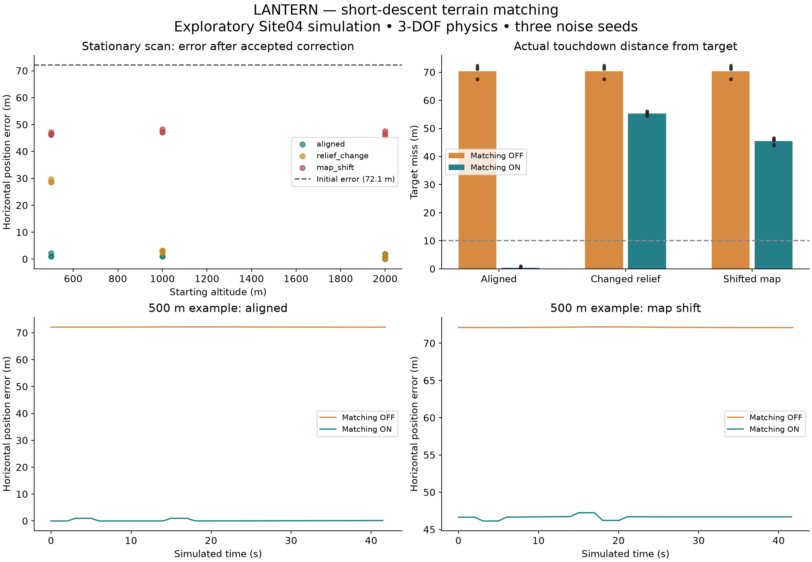

# LANTERN short-descent experiment: results and next work

Date: 21 October 2026. Measurement folder:
`out/terrain_matching/20261021_181450_v1/`.

## What changed

The new Unity experiment now uses estimated position and velocity for horizontal
guidance. Simulated lidar returns are expressed relative to the sensor; a
coarse-to-fine matcher fits them to the onboard map. Accepted corrections update
the estimate, which changes thrust commands. Physics and sensor generation can
read truth; the matcher and guidance module cannot read a Rigidbody or true pose.
Vertical guidance uses a simulated nadir altimeter and estimated vertical speed.

The simulated ground and onboard map are independent grids derived from Site04.
The two mismatch cases add a 12 m local Gaussian relief change to truth only,
or shift the onboard map coordinates by (+40,-24) m. Neither arm gets privileged
map access. Both compute matches; only the ON arm applies the correction.

This is a new isolated short-descent test. The older `Site04.unity` autopilot
still uses truth and must not be confused with this new controller.

## What ran

- 27 stationary scans: three altitudes, three map conditions, three seeds.
- 54 descents: the same 27 conditions with correction OFF and ON.
- Starts at 500, 1000 and 2000 m above local ground, descending at 10 m/s.
- Initial horizontal estimate error: (+60,-40) m, magnitude 72.11 m.
- Unity 6.3 PhysX, 0.05 s steps, isolated local physics scene in Play mode.
- 3-DOF translation with ideal attitude response limited to 10 degrees.
- Python summarizes the saved CSVs and creates plots. No ML training was run.

The synthetic checks passed for a known correction and its sign, ambiguous flat
terrain, empty scans and scans outside map bounds. An initial editor-only scene
creation attempt failed before simulation; the runner was corrected to enter
Play mode. Those failed smoke folders are retained separately from completed
smoke and v1 data. The completed 500 m smoke pair was examined before the full
matrix; this is an exploratory engineering evaluation, not an unseen test.

## Measured outcomes

Each row below has nine descents: three altitudes times three noise seeds.
Task success requires touchdown at <2 m/s vertical and <1 m/s horizontal speed,
within 10 m of the target. Slow touchdown alone is a different outcome.

| Map condition | Mean miss, matching OFF | Mean miss, matching ON | Target successes OFF / ON |
|---|---:|---:|---:|
| Aligned map | 70.31 m | 0.42 m | 0/9 / 9/9 |
| Changed local terrain | 70.32 m | 55.30 m | 0/9 / 0/9 |
| Misregistered map | 70.31 m | 45.43 m | 0/9 / 0/9 |

All 54 descents reached geometric touchdown. The largest recorded vertical
contact speed was 1.90 m/s; the largest horizontal speed was 0.76 m/s.

With the aligned map, mean final horizontal estimate error fell from 72.18 m
to 0.62 m. Stationary scans reduced the 72.11 m initial error to 0-3 m.
Mean target miss with matching ON was 0.12 m from 500 m, 0.41 m from 1000 m,
and 0.72 m from 2000 m.

Changed terrain exposed drift in the matching corrections: 90 of 165 accepted
proposals in ON descents left >10 m absolute horizontal error. In the shifted-map
ON descents, all 165 accepted proposals were wrong by that definition. These
are repeated, correlated scans, not 165 independent missions. OFF-run proposals
are diagnostic only and were never applied.

Stationary shifted-map scans produced heuristic confidence 0.998-0.999 while
leaving roughly 46-48 m absolute error. A sharp residual minimum does not prove
that the map coordinate frame is correct. The expected shift magnitude is
sqrt(40²+24²) = 46.65 m, consistent with the observed remaining error.

Matcher latency: desktop median 5.53 ms, p95 9.55 ms, excluding ray generation.
This is not a flight-computer timing result.

## Plain-language conclusion

**We now have a working demonstration that map matching can correct a wrong
position estimate and improve where the simulated lander arrives. With a good
map, the average miss dropped from about 70 metres to less than half a metre.
We also found the central weakness: when the map is wrong, the matcher can be
very confident and still guide the lander to the wrong place.**

The next research step is to detect unreliable map corrections and limit their
influence, then repeat the comparison on independent terrain. The present
results establish a prototype capability and a measurable failure mode. They do
not establish mission readiness, general robustness or publication novelty.

A global map-coordinate shift cannot generally be diagnosed from shape matching
against that same map alone. It needs independently checked map registration or
an independent position reference. Robust fitting can help with local changed
terrain; it does not create an absolute reference missing from the inputs.

## Reproduce and inspect

1. Save the active Unity scene.
2. Run `SensorTrust/Experiments/Run short-descent protocol v1`.
3. Run `python tools/summarize_terrain_experiment.py` in the repository root.
4. Open `SensorTrust/Experiments/Open latest experiment replay` and press Play.
   The view identifies itself as a replay of measured Unity results; selectors
   switch altitude, condition, seed and correction ON/OFF.

Primary evidence: `summary.csv`, `scans.csv`, per-run trajectories and sparse
point clouds, map grids, protocol copy, source snapshots and SHA-256 hashes in
the measurement folder. The source was frozen for the full matrix. Later view
changes do not alter measured trajectories. Use the frozen source snapshots to
reproduce that version if the live implementation changes.

