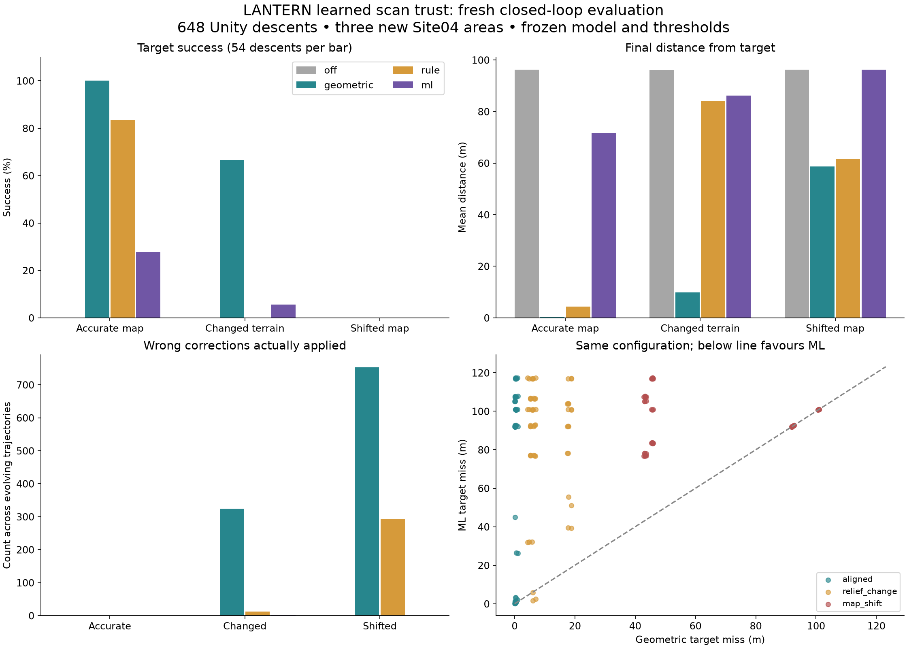

# Learned scan trust: measured closed-loop results

648 descents in three fresh, nonoverlapping Site04 areas; 162 paired four-arm configurations.
Initial offsets, noise seeds, relief perturbation and map translation differ from training.
The learned policy achieved 18/162 target successes; geometric matching achieved 90/162. This experiment does not support replacing the geometric gate with the learned veto.

| Map | Arm | Successes / 54 | Contacts | Mean target miss | Median | Max sideways impact |
|---|---|---:|---:|---:|---:|---:|
| aligned | off | 0/54 | 54 | 96.29 m | 96.68 m | 1.19 m/s |
| aligned | geometric | 54/54 | 54 | 0.36 m | 0.29 m | 0.04 m/s |
| aligned | rule | 45/54 | 54 | 4.29 m | 3.27 m | 1.12 m/s |
| aligned | ml | 15/54 | 54 | 71.62 m | 96.68 m | 3.36 m/s |
| relief_change | off | 0/54 | 54 | 96.15 m | 96.75 m | 1.32 m/s |
| relief_change | geometric | 36/54 | 54 | 9.89 m | 6.44 m | 0.18 m/s |
| relief_change | rule | 0/54 | 54 | 83.96 m | 92.47 m | 4.57 m/s |
| relief_change | ml | 3/54 | 54 | 86.18 m | 96.75 m | 4.57 m/s |
| map_shift | off | 0/54 | 54 | 96.29 m | 96.68 m | 1.19 m/s |
| map_shift | geometric | 0/54 | 54 | 58.75 m | 45.62 m | 0.92 m/s |
| map_shift | rule | 0/54 | 54 | 61.62 m | 46.16 m | 0.96 m/s |
| map_shift | ml | 0/54 | 54 | 96.29 m | 96.68 m | 1.19 m/s |

## Paired ML comparisons

ML versus off: mean target-distance reduction 11.55 m; 28 improved / 0 worsened / 134 tied of162. Conditional paired-bootstrap interval [7.63, 15.77] m.
ML versus geometric: mean target-distance reduction -61.69 m; 4 improved / 143 worsened / 15 tied of162. Conditional paired-bootstrap interval [-67.83, -55.47] m.
ML versus rule: mean target-distance reduction -34.74 m; 18 improved / 84 worsened / 60 tied of162. Conditional paired-bootstrap interval [-41.34, -28.43] m.

These intervals resample paired configurations within the three observed areas. They do not establish performance at independent lunar sites. All areas share Site04.

Median inference 0.0079 ms; p95 0.0206 ms on this desktop, including both rule and ML evaluations, excluding scan matching.

## Interpretation limits

The classifier sees only local matcher diagnostics. It has no independent absolute position reference. A globally translated map remains intrinsically ambiguous from shape fit alone. Rejecting more corrections can reduce wrong updates while leaving the initial navigation error uncorrected.
The raw summary accepted_matches/wrong_matches count geometric proposals. Use scan applied/applied_bad fields and gate_audit.csv for updates actually used by a policy.
The selected forest and threshold were chosen on area03 validation before these runs and were not changed after smoke or full outcomes. The original geometric core, controller, altimeter model and older experiment outputs are preserved.
The new integration controls correction use in the isolated estimated-state Unity experiment. It does not retrofit the original 102.5km Site04 scene. Vehicle attitude is idealized; sensors are synthetic.

## Reproduction

Protocol: SCAN_TRUST_PROTOCOL_V1.md. Unity menu: SensorTrust/Experiments/Run scan-trust protocol v1. Summarize with python tools/summarize_scan_trust.py. Frozen source, model/rule, protocol, parity report, case trajectories/clouds, scan decisions and source hashes are saved beside this report.

