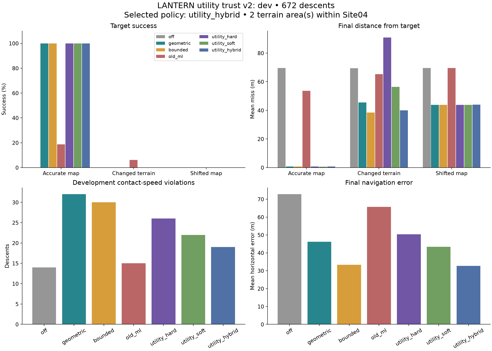

# Scan utility v2: dev results

672 descents; 96 paired configurations. Selected policy: utility_hybrid.

| Arm | Successes | Contacts | Mean target miss | Speed violations |
|---|---:|---:|---:|---:|
| off | 0/96 | 96 | 69.56m | 14 |
| geometric | 32/96 | 96 | 30.03m | 32 |
| bounded | 32/96 | 96 | 27.67m | 30 |
| old_ml | 8/96 | 96 | 62.87m | 15 |
| utility_hard | 32/96 | 96 | 45.19m | 26 |
| utility_soft | 32/96 | 96 | 33.60m | 22 |
| utility_hybrid | 32/96 | 96 | 28.18m | 19 |

| Condition | Arm | Successes | Mean miss |
|---|---|---:|---:|
| aligned | off | 0/32 | 69.61m |
| aligned | geometric | 32/32 | 0.75m |
| aligned | bounded | 32/32 | 0.75m |
| aligned | old_ml | 6/32 | 53.67m |
| aligned | utility_hard | 32/32 | 0.77m |
| aligned | utility_soft | 32/32 | 0.63m |
| aligned | utility_hybrid | 32/32 | 0.68m |
| relief_positive | off | 0/32 | 69.46m |
| relief_positive | geometric | 0/32 | 45.48m |
| relief_positive | bounded | 0/32 | 38.40m |
| relief_positive | old_ml | 2/32 | 65.34m |
| relief_positive | utility_hard | 0/32 | 90.94m |
| relief_positive | utility_soft | 0/32 | 56.40m |
| relief_positive | utility_hybrid | 0/32 | 39.92m |
| map_shift | off | 0/32 | 69.61m |
| map_shift | geometric | 0/32 | 43.85m |
| map_shift | bounded | 0/32 | 43.85m |
| map_shift | old_ml | 0/32 | 69.61m |
| map_shift | utility_hard | 0/32 | 43.85m |
| map_shift | utility_soft | 0/32 | 43.78m |
| map_shift | utility_hybrid | 0/32 | 43.94m |

This utility model rewards useful error reduction, rather than rejecting every correction that leaves >10m error. Partial corrections and small updates require the original geometric gate. Ground truth supplies labels/evaluation only.
Development outcomes selected the policy. Final evaluation uses a separately reserved area, new offsets, seeds, perturbations and1500m altitude. Only one nonoverlapping fresh eligible crop remained; this is a narrow Site04 test, not independent-site generalization evidence.
A coherent global map shift still needs independent registration information. Local match diagnostics cannot uniquely establish absolute location.
All records, routing checks, frozen source/model/protocol, trajectories and sparse clouds are retained. Compare methods within this batch: actual start offsets and map perturbations differ from v1.

