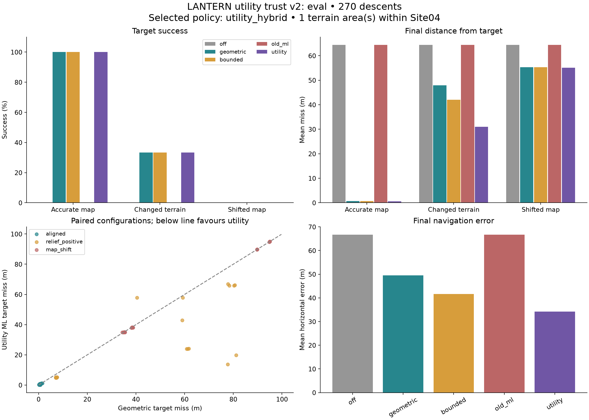

# Scan utility v2: eval results

270 descents; 54 paired configurations. Selected policy: utility_hybrid.

| Arm | Successes | Contacts | Mean target miss | Speed violations |
|---|---:|---:|---:|---:|
| off | 0/54 | 54 | 64.40m | 0 |
| geometric | 24/54 | 54 | 34.64m | 12 |
| bounded | 24/54 | 54 | 32.67m | 12 |
| old_ml | 0/54 | 54 | 64.40m | 0 |
| utility | 24/54 | 54 | 28.92m | 7 |

| Condition | Arm | Successes | Mean miss |
|---|---|---:|---:|
| aligned | off | 0/18 | 64.39m |
| aligned | geometric | 18/18 | 0.73m |
| aligned | bounded | 18/18 | 0.73m |
| aligned | old_ml | 0/18 | 64.39m |
| aligned | utility | 18/18 | 0.59m |
| relief_positive | off | 0/18 | 64.42m |
| relief_positive | geometric | 6/18 | 47.90m |
| relief_positive | bounded | 6/18 | 41.99m |
| relief_positive | old_ml | 0/18 | 64.42m |
| relief_positive | utility | 6/18 | 31.05m |
| map_shift | off | 0/18 | 64.39m |
| map_shift | geometric | 0/18 | 55.29m |
| map_shift | bounded | 0/18 | 55.29m |
| map_shift | old_ml | 0/18 | 64.39m |
| map_shift | utility | 0/18 | 55.11m |

This utility model rewards useful error reduction, rather than rejecting every correction that leaves >10m error. Partial corrections and small updates require the original geometric gate. Ground truth supplies labels/evaluation only.
Development outcomes selected the policy. Final evaluation uses a separately reserved area, new offsets, seeds, perturbations and1500m altitude. Only one nonoverlapping fresh eligible crop remained; this is a narrow Site04 test, not independent-site generalization evidence.
A coherent global map shift still needs independent registration information. Local match diagnostics cannot uniquely establish absolute location.
All records, routing checks, frozen source/model/protocol, trajectories and sparse clouds are retained. Compare methods within this batch: actual start offsets and map perturbations differ from v1.

