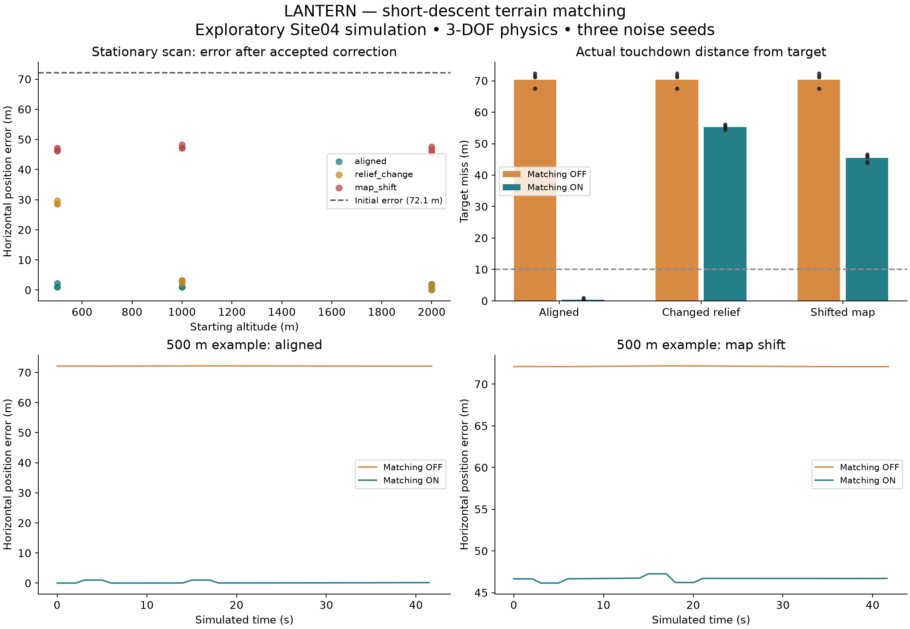

# Short-descent terrain matching — measured results

Run folder: `20261021_181450_v1`

27 stationary scans and 54 descents. Paired-run completeness and unique IDs checked.

| Map condition | Matching | Runs | Touchdowns | Task successes | Mean target miss | Mean final horizontal error | Wrong / accepted matches |
|---|---|---:|---:|---:|---:|---:|---:|
| aligned | OFF | 9 | 9 | 0 | 70.31 m | 72.18 m | 0 / 165 |
| aligned | ON | 9 | 9 | 9 | 0.42 m | 0.62 m | 0 / 165 |
| relief_change | OFF | 9 | 9 | 0 | 70.32 m | 72.18 m | 51 / 165 |
| relief_change | ON | 9 | 9 | 0 | 55.30 m | 61.98 m | 90 / 165 |
| map_shift | OFF | 9 | 9 | 0 | 70.31 m | 72.18 m | 165 / 165 |
| map_shift | ON | 9 | 9 | 0 | 45.43 m | 46.35 m | 165 / 165 |

Matcher latency on this desktop: median 5.53 ms; p95 9.55 ms. Excludes scan generation; not a flight-computer benchmark.

## How to interpret this

Task success means touchdown below 2 m/s vertical speed and 1 m/s horizontal speed, within 10 m of the target. A touchdown can occur without task success.
Wrong match means an accepted proposed correction leaves more than 10 m of horizontal position error. OFF runs compute matches for measurement but do not apply them.
Map-shift tests assess absolute position: a plausible shape match can be confidently wrong when the map coordinate frame is wrong.

## Limits

This is an exploratory test at one Site04 location, with three noise seeds, fixed initial errors and simplified 3-DOF control. Seeds are not independent terrain sites. No publication/generalisation claim is supported.
The IMU and altimeter are assumed models; attitude response is ideal. The onboard map and simulated ground derive from the same DEM, with controlled perturbations and independent grids. No new physical surface detail is recovered merely by rendering a mesh.
The rendered scene is explicitly a replay of recorded Unity PhysX data. The actual experiments ran in an isolated Unity physics scene, not in Python. Python only summarized and plotted the CSVs. No ML training was performed.

## Reproduce

In Unity use `SensorTrust/Experiments/Run short-descent protocol v1`, then run `python tools/summarize_terrain_experiment.py`. The output includes the protocol, source snapshots/hashes, map grids, scans and trajectories.

