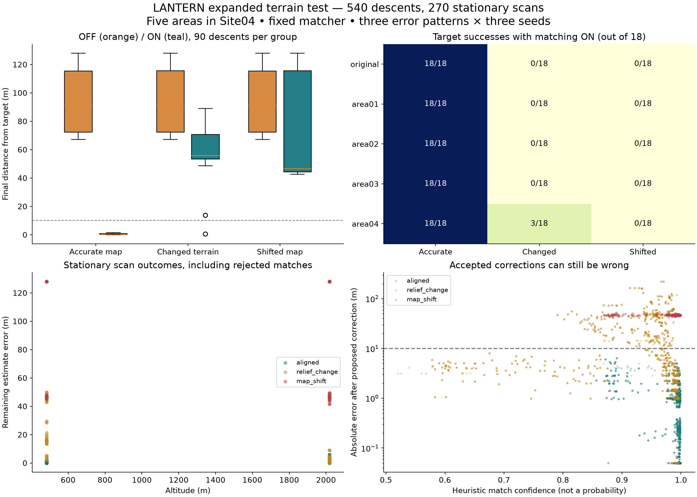

# Expanded terrain-matching test: measured results

Folder: `20261021_183805_expanded_v2`

270 stationary scans and 540 descents (270 matched OFF/ON pairs). Five regions in the same lunar DEM, two starting altitudes, three initial position errors, three noise seeds, three map conditions.

| Map condition | Matching | Runs | Contacts | Target successes | Mean final distance | Median | 90th percentile |
|---|---|---:|---:|---:|---:|---:|---:|
| aligned | OFF | 90 | 90 | 0 | 93.94 m | 90.94 m | 127.68 m |
| aligned | ON | 90 | 90 | 90 | 0.49 m | 0.33 m | 0.97 m |
| relief_change | OFF | 90 | 90 | 0 | 93.95 m | 90.94 m | 127.68 m |
| relief_change | ON | 90 | 90 | 3 | 57.96 m | 55.79 m | 75.45 m |
| map_shift | OFF | 90 | 90 | 0 | 93.94 m | 90.94 m | 127.68 m |
| map_shift | ON | 90 | 90 | 0 | 70.81 m | 46.64 m | 127.68 m |

## Area-level target successes

| Area | Accurate OFF / ON | Changed OFF / ON | Shifted OFF / ON |
|---|---:|---:|---:|
| original | 0/18 / 18/18 | 0/18 / 0/18 | 0/18 / 0/18 |
| area01 | 0/18 / 18/18 | 0/18 / 0/18 | 0/18 / 0/18 |
| area02 | 0/18 / 18/18 | 0/18 / 0/18 | 0/18 / 0/18 |
| area03 | 0/18 / 18/18 | 0/18 / 0/18 | 0/18 / 0/18 |
| area04 | 0/18 / 18/18 | 0/18 / 3/18 | 0/18 / 0/18 |

## Pairing and limitations

Matching reduced final target distance in 232/270 pairs and increased it in 9/270. Mean paired reduction: 50.85 m. Pooled figures can hide site/condition failures; use the tables above.
Geometric contact: 540/540. Contacts below 2 m/s vertical: 540/540. A slow touchdown can miss the target.
Matcher desktop latency: median 4.83 ms, p95 7.54 ms, excluding scan generation. This is not flight-computer timing.
Target success requires actual PhysX terrain contact, vertical speed <2 m/s, horizontal speed <1 m/s and target miss <10 m. Final distances include timeouts; the Contacts column identifies completion.
V2 records actual collision relative velocity; v1 used an 8 cm proximity stop. Compare the OFF/ON arms within this batch rather than treating differences from v1 as an algorithm improvement.
Matcher, navigation and guidance source hashes match v1 exactly. Terrain setup is cached; vehicle, filter, fuel and random generator reset per run. No ML training or threshold tuning was performed.
The five targets were chosen before outcomes using a deterministic distance/slope rule. All targets are in Site04. This tests variation within one dataset; it does not establish performance at other lunar sites. The vehicle still has ideal attitude response and 3-DOF dynamics.
Confidence is residual contrast, not calibrated probability. A globally shifted map can match shapes well while being wrong in absolute coordinates; diagnosing that requires independent registration evidence.

## Evidence and reproduction

Protocol, site manifest, frozen C# source and SHA-256 hashes, 810 trajectory/cloud pairs, scan records and per-site/per-altitude/per-error tables are saved here.
Unity menu: `SensorTrust/Experiments/Run expanded terrain protocol v2`. Plan: `python tools/plan_expanded_terrain_tests.py`. Summarize completed data: `python tools/summarize_expanded_terrain_tests.py`.

